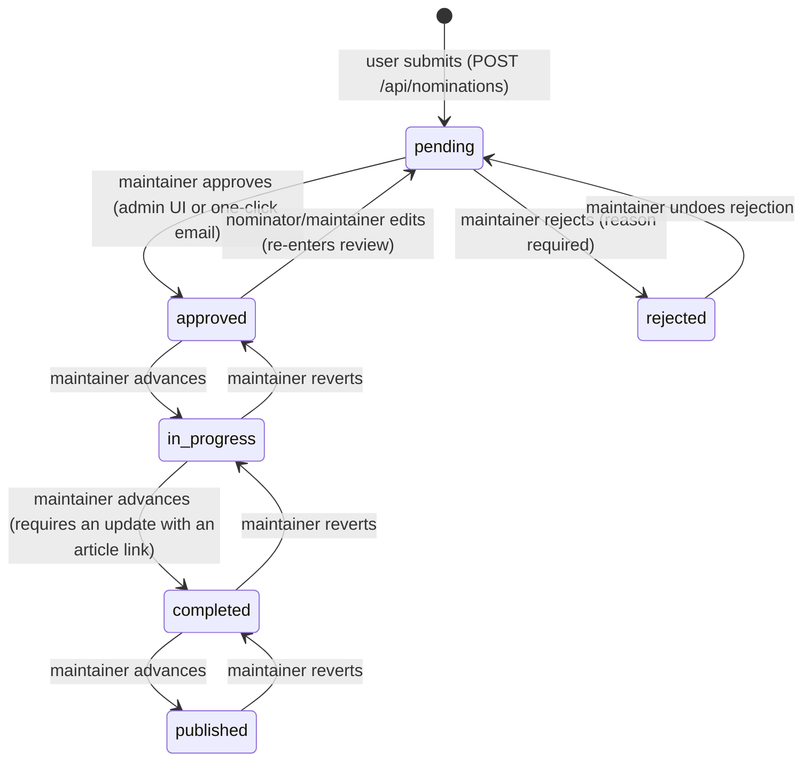

# Replicate This: system reference

Everything the system does and stores, in one place: the nomination lifecycle,
the full database schema, roles and permissions, notifications, integrations,
the privacy model, configuration, and how the web app behaves. For the *why* behind the architecture decisions, see
[ARCHITECTURE.md](ARCHITECTURE.md).

- **Stack:** React SPA (`web/`, Vite + React Router + TanStack Query + Tailwind)
  → Hono API (`server/`, Better Auth + Drizzle) → Postgres. The SPA never
  touches Postgres; all authorization happens in API route handlers.
- **Dev URLs:** web `http://localhost:5173/replicate-this/` (port pinned, because
  auth trusts exact origins), API `http://localhost:8787`; Vite proxies `/api` →
  `8787`. `npm run dev:remote` in `web/` uses the deployed API instead (§ 8).
- **Production:** web on GitHub Pages at `https://forrt.org/replicate-this`, API
  at `https://api-replicate-this.keeganvaz.in` (§ 9).

---

## 1. Nomination lifecycle

### States

| Status | Meaning | Publicly visible? |
|---|---|---|
| `pending` | Submitted, awaiting maintainer review. Shown as **"Pending review"**. | Yes |
| `approved` | Reviewed and open for contributors. Shown as **"Looking for contributors"**. | Yes |
| `in_progress` | A replication team is actively working. | Yes |
| `completed` | The replication/reproduction is done; a linked article exists. Terminal (may still advance to published). | Yes |
| `published` | The resulting study is formally published. Terminal. | Yes |
| `rejected` | Declined by a maintainer (reason required). Hidden from the registry; visible only to the nominator and maintainers. | No |

### Transitions

Rules enforced in code:

- **Submission** (`server/src/routes/nominations.ts`): by DOI, deduplicated:
  a DOI can only be re-nominated if the previous nomination was `rejected`. The
  form previews the resolved reference as the DOI is typed
  (`GET /api/nominations/lookup`). Reference metadata is fetched from Crossref,
  falling back to doi.org content negotiation, falling back to manual entry
  (`metadataManual`). Papers with no DOI (`noDoi: true`) are submitted with a
  hand-entered reference (title required, optional link) and a null `doi`.
  A hand-entered year must be four digits from 1600 to next year.
  Choosing the "Other" discipline requires a free-text `disciplineOther`.
  Justification must be ≥ 20 characters (checked in the browser and again on
  the server).
- **Approval** (`server/src/lib/moderation.ts`): flips `pending → approved`,
  logs to `moderation_logs` and notifies the nominator and subscribers. When
  `SLACK_BOT_TOKEN` is set it also creates the team's locked Slack channel
  (the integration is on hold; see § 6).
  Shared by the admin UI and the one-click email review flow.
- **Rejection** requires a written reason (stored in `moderation_logs.reason`
  and sent to the nominator). The email flow only rejects still-`pending`
  nominations; the admin API can reject at later statuses too.
- **Editing** (`PATCH /api/nominations/:id`): allowed for the nominator or a
  maintainer while status is `pending` or `approved`. The DOI and fetched
  reference are immutable (a different paper = a new nomination). **Every edit
  sends the nomination back to `pending`** for re-review.
- **Lifecycle advance/revert** (`POST /api/admin/nominations/:id/status`):
  maintainers may set `approved | in_progress | completed | published`.
  Reverting to an earlier status is always allowed. Advancing to `completed`
  is gated: the team must first post a progress update carrying an
  `articleUrl` (the "completion request").
- Every moderation action writes a row to `moderation_logs`.

### The study team

- **Contributing** is auto-accepted (no approval handshake): any signed-in user
  except the nominator can join via `POST /api/contributions/:id`, optionally
  with a pitch message, and may withdraw at any time.
- **The team** (nominator + contributors + maintainers) can post progress
  updates. An update with an article link asks maintainers to mark the study
  completed.
- **Slack** (on hold): the join panel is not shown in the web app. See § 6.

---

## 2. Database schema

Schema source: [`server/src/db/schema.ts`](../server/src/db/schema.ts).
Migrations in `server/drizzle/` (`npm run db:generate` → `db:migrate`; local
dev DBs are typically synced with `db:push`).

### Auth tables (Better Auth)

**`user`**: one row per account. The login identity is a dummy by design (see § 7):

| Column | Type | What it stores |
|---|---|---|
| `id` | text PK | Better Auth's random, non-identifying id. First 8 chars double as the public "researcher token" (`#eFpGkVB`). |
| `name` | text | Display name. Starts as the OAuth profile name (we encourage real names), or a random pseudonym (e.g. `BrightQuasar42`) when the provider gives none or it is taken past `Name 9`. User-editable, with a Randomize button suggesting pseudonyms; unique case-insensitively among non-deleted users. |
| `email` | text unique | **Not a real email.** Deterministic dummy `<sha256(email + EMAIL_PEPPER)>@privacy.forrt.org`, derived from the provider email (or the ORCID iD). Exists only so one person links across providers. |
| `email_verified` | boolean | Always true (providers verified the underlying address). |
| `image` | text | Always null (stripped). |
| `role` | text | `user` \| `maintainer`. Never settable by the client; granted via the admin UI (guardrails: no self-change, never zero maintainers). |
| `deleted` | boolean | Soft-delete tombstone: login severed, PII cleared, name becomes "Deleted account"; the user's content remains attributed to that tombstone. |
| `links` | jsonb | **Opt-in** public profile links, each normalised to one canonical URL (`server/src/lib/profile-links.ts`): `orcid` (checksum-validated; bare iD or URL stored identically), `website`, `bluesky`, `mastodon`, `github`, `scholar`, `osf`, `linkedin`, `twitter` (handles such as `@you.bsky.social` or `@you@instance` expand to profile URLs; ≤ 300 chars). |
| `notification_email` | text | Address for email notifications. Prefilled with the provider email at first Google/GitHub sign-in (`rememberSignupProfile` in `auth.ts`), empty for ORCID; the user can change or clear it. Empty = no emails. The only real email the system stores. |
| `email_prefs` | jsonb | Which categories to email: `my_nominations`, `contributions`, `watched`, `admin` (maintainers only). All on for new accounts; an untouched `{}` also reads as all on. |
| `created_at`, `updated_at` | timestamp | |

**`session`**: `id`, unique signed `token`, `expires_at`, `ip_address`,
`user_agent`, `user_id` (cascade). Cookie: `replicate-this.session_token`,
httpOnly, secure in production. It is sameSite=lax when the web app and API
share a site, and sameSite=none in production, where they don't. Browsers drop
that cross-site cookie, so production sign-in runs in a popup that hands the
web app a session token, sent back as a bearer header (`server/src/auth.ts`,
`web/src/lib/popup-sign-in.ts`).

**`account`**: one row per linked OAuth provider: `provider_id`
(google/github/orcid), `account_id` (the provider's user id), OAuth
`scope`. Accounts resolving to the same dummy email are linked automatically.
The `access_token` / `refresh_token` / `id_token` columns exist because Better
Auth's account model defines them, and are always null: `account.create.before`
and `account.update.before` hooks discard the provider tokens before every
write (`server/src/lib/oauth-tokens.ts`), so neither first sign-in, repeat
sign-in nor account linking persists one. A Google `id_token` is a JWT carrying
the real email, name and picture; the app makes no provider calls after
sign-in, so nothing needs the tokens.

**`verification`**: Better Auth's short-lived OAuth state/PKCE rows.

### Application tables

**`nominations`**: the registry's core row:

| Column | Type | What it stores |
|---|---|---|
| `id` | uuid PK | |
| `doi` | text unique, nullable | Normalised DOI. Null for papers without one. Immutable after submission. |
| `metadata` | jsonb | Cached reference: `title`, `authors[]`, `journal`, `publication_date`, plus `url` for DOI-less papers. From Crossref/doi.org, or manual entry. |
| `metadata_manual` | boolean | True when the reference was hand-entered (no DOI, or DOI lookup failed). |
| `discipline` | text | One of: Psychology, Medicine, Economics, Biology, Physics, Sociology, Education, Linguistics, Marketing, Neuroscience, Other. |
| `discipline_other` | text | The nominator's wording when `discipline` is Other ("please specify"); shown in place of "Other". |
| `verification_type` | text | `replication` (new data) \| `reproduction` (re-run the original data/code, and/or vary the analysis to check robustness; for simulation studies, the code) \| `both` (either / not sure). |
| `availability` | jsonb string[] | What the nominator says is open: `open_data`, `open_code`, `open_materials`, `preregistration`, `open_access`. |
| `availability_links` | jsonb | Optional http(s) URL per availability key (e.g. `{ open_data: "https://osf.io/…" }`). |
| `justification` | text | Why this paper deserves a second look (≥ 20 chars). |
| `data_location` | text | Where the original data/code live (reproductions). |
| `robustness_checks` | text | Suggested alternative specifications (optional). |
| `design_deviations` | text | For replications: how the new design should differ (optional). |
| `replication_games` | boolean | Nominator-set "Workshop Suitability" tag: the paper suits a one-day Replication Workshop (Institute for Replication). Code name `replicationWorkshop`; the column keeps its old name. |
| `experimental_research` | boolean | Nominator-set flag that the study is experimental research. Gates the ReScience X target-journal tag. |
| `slack_channel_id` / `slack_channel_name` | text | The team's locked Slack channel, created at approval when the integration is configured. Empty = none. Only the *name* is exposed to the client. |
| `nominator_uid` | text FK → user (set null) | |
| `status` | text | Lifecycle state (§ 1). |
| `last_milestone` | integer | Highest upvote milestone already alerted to admins (prevents re-alerts). |
| `last_activity_at` | timestamptz | Bumped by comments, progress updates and edits; drives the "Most active" sort. |
| `created_at` | timestamptz | |

**`votes`**: upvotes ("I want this replicated / reproduced / revisited",
worded by the requested check). PK (`nomination_id`, `user_uid`); row presence
= an upvote. The button toggles it; separate add-only and remove-only endpoints
finish an upvote clicked while signed out and undo it (§ 4, § 10). Login
required, no account-age gate. Milestone counts trigger one-time admin alerts.

**`predictions`**: yes/no forecasts. PK (`nomination_id`, `user_uid`) +
`will_replicate` boolean (read as "yes"). The question shown follows the
verification type: "Will it replicate?", "Will the results prove robust?"
(reproductions) or "Will the finding hold up?" (both). Shown as an aggregate
yes/no distribution; changeable or clearable by the voter. With fewer than five
responses the summary reports counts ("The one prediction so far is Yes")
instead of naming a majority.

**`contributions`**: auto-accepted membership of a study's team. PK (`nomination_id`,
`contributor_uid`) + unique `id`, optional `message` (pitch: expertise, lab,
timeline). The public roster shows display name + token + message.

**`comments`**: public, Reddit-style threaded discussion: `parent_id`
(null = top-level), `author_uid`, `content` (rendered as a safe Markdown
subset), `hidden` (maintainer moderation: kept for audit, not shown publicly).

**`comment_likes`**: PK (`comment_id`, `user_uid`); row presence = a like,
toggled on/off.

**`comment_flags`**: user reports of a comment against the Code of Conduct.
PK (`comment_id`, `user_uid`) + optional `reason`, `resolved_at`. A first flag
alerts maintainers; flagged comments sort first in the comment moderation
queue, and hiding or keeping the comment resolves its flags.

**`subscriptions`**: GitHub-style "watch". PK (`nomination_id`, `user_uid`).
Subscribers get notifications for comments, updates, contributors, and status
changes (except for activity they caused themselves).

**`nomination_updates`**: progress updates from the team (2–5000 chars).
`article_url` non-empty ⇒ doubles as a **completion request** that alerts
maintainers.

**`inquiries`**: private "contact the team" messages: `sender_uid`,
`content`, `delivery_status`, `read_at`. Recipients (nominator + contributors)
are notified in-app.

**`notifications`**: the in-app inbox: `user_uid`, `type` (§ 5), `data`
jsonb (usually `{ nominationId, … }`), `read_at`.

**`moderation_logs`**: audit trail of every admin action: `admin_uid`,
`nomination_id` (nullable; role changes have none), `action` (e.g.
`approved`, `rejected`, `undo_rejection`, `set_status_completed`,
`revert_status_approved`, `edited`, `hide_comment`, `unhide_comment`,
`grant_maintainer`),
`reason`.

### Derived values (not stored)

- **Target-journal tags** (R², Journal of Robustness Reports, JCRE,
  ReScience C, ReScience X) are computed on the fly from discipline /
  verification type / availability (`web/src/features/nominations/journal-tags.ts`),
  so rule changes retroactively update every card.
- **Researcher token** = first 8 chars of the user id, derived at read time.
- **Aggregates** (upvotes, prediction split, contribution/comment/subscriber
  counts) are `count(*)` joins in `server/src/db/queries.ts`, never denormalised.

---

## 3. Roles & permissions

| Action | Signed-out | User | Nominator (own study) | Contributor | Maintainer |
|---|---|---|---|---|---|
| Browse registry, read comments/updates | ✅ | ✅ | ✅ | ✅ | ✅ |
| Nominate / upvote / predict / comment / subscribe | — | ✅ | ✅ | ✅ | ✅ |
| Contribute to a study | — | ✅ | — (already the nominator) | withdrawn only | ✅ |
| Edit a nomination (while pending/approved) | — | — | ✅ | — | ✅ |
| Post progress updates | — | — | ✅ | ✅ | ✅ |
| Join the study's Slack channel (on hold) | — | — | ✅ | ✅ | — |
| Send an inquiry to the team | — | ✅ | — | — | ✅ |
| Approve / reject / set lifecycle status | — | — | — | — | ✅ |
| Hide comments, manage user roles | — | — | — | — | ✅ |
| See rejected nominations | — | — | own only | — | ✅ |

A signed-out visitor who clicks upvote or a forecast is sent to sign in, and
that click is applied once they are back (§ 10).

---

## 4. API surface

All routes live under `/api` (`server/src/app.ts`). Session is resolved for
everything except `/api/auth/*` (Better Auth) and `/api/email-actions/*`
(signed-token auth).

| Router | Endpoints |
|---|---|
| `/api/auth/*` | Better Auth: sign-in (Google, GitHub, ORCID), session, sign-out. |
| `/api/nominations` | `GET /` public list · `GET /mine` · `GET /lookup?doi=` live reference preview + duplicate check · `GET /:id` detail · `GET /:id/contributors` · `POST /` submit · `PATCH /:id` edit |
| `/api/votes` | `POST /:id/toggle` upvote · `PUT /:id` add (no-op if present) · `DELETE /:id` remove: used to finish an upvote clicked while signed out, and to undo it |
| `/api/predictions` | `PUT /:id` set/clear yes-no prediction (returns the previous value, for Undo) |
| `/api/contributions` | `POST /:id` join · `DELETE /:id` withdraw · `GET /mine` |
| `/api/comments` | `GET /:id` threaded list (with like counts) · `POST /:id` comment/reply · `POST /:commentId/like` toggle · `POST /:commentId/flag` report (no user deletion; maintainers hide via admin) |
| `/api/researchers` | `GET /:token` public profile by 8-char researcher token: name, avatar, links, public nominations and contributions |
| `/api/subscriptions` | `POST /:id/toggle` watch |
| `/api/updates` | `GET /:id` timeline · `POST /:id` post update (+ completion request) |
| `/api/inquiries` | `POST /:id` message the team |
| `/api/notifications` | inbox list / mark read |
| `/api/profile` | get/update display name (uniqueness-checked), profile links (normalised, ORCID checksum-validated), notification email + prefs; account deletion (soft) |
| `/api/slack` | `POST /nominations/:id/join`: invite the signed-in team member into the study's locked channel (on hold; § 6) |
| `/api/admin` | moderation queue, approve/reject/undo, lifecycle status, user list + role management, comment moderation |
| `/api/email-actions` | one-click approve/reject from maintainer review emails, authenticated by a signed token (HMAC, 14-day expiry) instead of a session |
| `/api/health`, `/api/providers` | liveness; which OAuth providers are configured |

---

## 5. Notifications & email

Every event lands in the **in-app inbox** (`notifications` table). Email is
**opt-in** per category: a `notification_email` must be present (prefilled from
Google/GitHub at sign-up, or entered by the user) *and* the category enabled. Sending is best-effort (Postmark; disabled when
`POSTMARK_API_TOKEN` is blank) and never fails the request.

New accounts get an in-app `welcome` notification (no email) pointing to open
studies; migration `0017` backfilled it for existing accounts.

| Category (pref) | Types |
|---|---|
| `my_nominations` | `nomination_approved`, `nomination_rejected`, `nomination_completed`, `nomination_published`, `nomination_admin_edited` |
| `contributions` | `new_contribution`, `new_inquiry`, `team_member_joined` |
| `watched` | `watched_comment`, `watched_update`, `watched_contribution`, `watched_status` |
| `admin` (maintainers) | `new_nomination`, `nomination_edited`, `completion_requested`, `upvote_milestone` |

New comments and inquiries, and comments flagged by users
(`moderation_new_comment`, `moderation_new_inquiry`,
`moderation_comment_flagged`), reach maintainers in-app and as one email to
the shared `ADMIN_EMAIL` inbox (`server/src/lib/admin-alerts.ts`), regardless of
personal email preferences.

Maintainer review emails for new/edited nominations embed the study details
plus per-recipient **one-click approve/reject buttons** (signed tokens, 14-day
expiry, `server/src/lib/email-actions.ts`).

---

## 6. Integrations

### DOI / reference lookup
Crossref first, then doi.org content negotiation, then manual entry
(`server/src/lib/crossref.ts`). Successful lookups are cached in memory for 30
minutes, since the form previews a DOI and then submits it.

### Slack (community discussion channels): on hold
The web app no longer shows the join panel (`SlackJoinPanel` is kept but not
rendered). The server code is unchanged, so channels are still created on
approval whenever `SLACK_BOT_TOKEN` is set. When it was active:

- **On approval**, a **locked (private) channel** is created in the community
  workspace, named after the paper title with a `-discussion` suffix (80-char
  Slack limit; `name_taken` collisions retried with a nomination-id fragment).
  Creation is fail-safe: Slack problems never block moderation.
- **Joining:** contributors and the nominator see a "Slack discussion" panel on
  the study page. They enter the email on their Slack account; the server calls
  `users.lookupByEmail` and `conversations.invite`. **The email is used once
  and never stored.**
- **No Slack account yet:** Slack's API cannot create accounts or force-add
  workspace members on standard plans, so the user gets the standing workspace
  invite link (`SLACK_INVITE_URL`), joins, then retries, and the channel invite
  then completes automatically.
- **Backfill:** `npm run slack:backfill` creates channels for studies approved
  before the integration was configured (optionally one id as an argument).
- Requires a Slack app with bot scopes `groups:write`, `users:read`,
  `users:read.email`; the bot must stay in the channels it creates.

### Postmark (email)
See § 5. EU data region; a blank token disables email.

### Public export
`npm run export:data` in `server/` writes `exports/nominations.json` (the full
public registry) and `exports/STATS.md` (totals by status and discipline).
No workflow in `.github/workflows/` runs it at present, so it is run by hand.

---

## 7. Privacy model (minimal PII)

- **At sign-in**, `mapProfileToUser` + a `user.create.before` hook replace the
  OAuth profile before any write: deterministic dummy email, no image
  (`server/src/auth.ts`). We encourage real names, so a new account's display
  name starts as the provider's profile name (Google `profile` scope, GitHub
  name, ORCID given/family name), falling back to a random pseudonym. Google
  sign-in requests openid/email/profile; ORCID only `openid`.
- **Public attribution** is display name + 8-char token; names link to a public
  profile page at `/researchers/:token`.
- **Stored PII** is limited to the display name (provider name unless changed),
  the optional profile links (user-entered) and the notification email
  (prefilled from the Google/GitHub profile at sign-up, empty for ORCID). The
  user can change or remove all three.
- **Transient PII:** the Slack-account email (§ 6) is forwarded to Slack's API
  and never persisted.
- **Account deletion** is a soft delete: credentials severed, PII cleared,
  name → "Deleted account"; contributions/comments/votes remain under the
  tombstone so threads stay coherent.
- **Sessions** store `user_agent` (and have an `ip_address` column).
- **OAuth tokens** are discarded at sign-in and never stored (see § 2).

---

## 8. Environment variables

From [`server/src/lib/env.ts`](../server/src/lib/env.ts) /
[`.env.example`](../server/.env.example). Dev fallbacks exist for everything
except where noted; production must set them all.

| Variable | Purpose |
|---|---|
| `NODE_ENV`, `PORT` | Runtime mode; API port (default 8787). |
| `DATABASE_URL` | Postgres connection string. |
| `WEB_ORIGIN` | Public URL of the web app, base path included (`https://forrt.org/replicate-this`). Emails link to it; its origin is trusted for CORS and sign-in. Port drift ⇒ 403s on sign-in (the dev port is pinned via `strictPort`). |
| `EXTRA_WEB_ORIGINS` | Optional, comma-separated extra origins trusted for CORS and sign-in, e.g. `http://localhost:5173` so `npm run dev:remote` can use this API. Anything listed can make signed-in requests: set it temporarily, then remove it and restart. |
| `BETTER_AUTH_URL`, `BETTER_AUTH_SECRET` | Auth base URL; cookie/token signing secret (≥ 32 chars). |
| `UID_PEPPER`, `EMAIL_PEPPER` | Secret peppers. `EMAIL_PEPPER` keys the dummy login email, so rotating it breaks account linking. `UID_PEPPER` is required but not used by any derivation today. |
| `GOOGLE_/GITHUB_/ORCID_CLIENT_ID/SECRET` | OAuth providers; unset pairs simply hide that sign-in button. |
| `ADMIN_EMAIL` | Shared inbox for admin alerts. |
| `POSTMARK_API_TOKEN`, `POSTMARK_FROM_EMAIL` | Transactional email; blank token = email disabled. |
| `SLACK_BOT_TOKEN` | Community workspace bot token; blank = Slack integration disabled. Read at server start, so restart after changing it. |
| `SLACK_INVITE_URL` | Standing workspace invite link. These expire, so rotate it periodically. |

The web app has one build-time variable, `VITE_API_ORIGIN`: the API's origin
when it is on another site. Empty means same-origin `/api`. The Pages build
takes it from the `VITE_API_ORIGIN` Actions variable, falling back for now to
`https://api-replicate-this.keeganvaz.in`; `web/.env.remote` sets it for
`npm run dev:remote`.

---

## 9. Operational notes

- **Deploys:** pushing to `main` deploys the web app (`deploy.yml`, GitHub
  Pages) and the API (`deploy-api.yml`: test and build in CI, copy to the
  aaPanel server over SSH, then `server/deploy-post.sh` installs dependencies,
  applies pending migrations and restarts PM2).
- **One API process:** PM2 runs a single fork (`ecosystem.config.cjs`) because
  sign-up hands the provider email from one auth hook to the next through an
  in-process `Map`. A second worker would drop notification addresses.
- **Migrations:** `npm run db:generate` after schema changes. Deploys apply them
  automatically (`node dist/db/migrate.js`); locally use `db:migrate`, or
  `db:push` to sync a scratch database.
- **Seed/demo data:** `npm run db:seed` / `db:demo`; `npm run make-admin`
  grants the maintainer role.
- **Tests:** `npm test` in `server/` (email hashing, email-action tokens, OAuth
  token scrubbing, profile links, Crossref, Slack client) and in `web/` (status
  labels, journal tags, search, forecast wording, year rule, pending actions,
  Markdown rendering, formatting).
- **`.env` is read once at startup.** Restart the API after editing it.

---

## 10. Web app behaviour

Behaviour that spans pages, and where it lives in `web/src`:

- **Registry state in the URL.** Search (`q`), filters (`discipline`,
  `status`, `journal`) and sort (`sort`) are query parameters
  (`pages/RegistryPage.tsx`), so a filtered view can be shared and survives a
  visit to a study. Search matches title, authors, journal and DOI, accepts a
  DOI link, and ignores accents (`features/nominations/search.ts`).
- **Back keeps your place.** A card passes the list URL to the study page, whose
  back link returns to it through history, so the scroll position is restored
  too.
- **Page changes are announced.** Every page sets its tab title
  (`lib/page-title.ts`). On a change of path, `RouteAnnouncer` moves focus to
  `<main>` (or, going Back, to the link that was used) and reads the new title
  to screen readers. Query-string changes, such as typing in search, are
  ignored.
- **Signed-out clicks are finished after sign-in.** An upvote or forecast
  clicked while signed out is saved in `sessionStorage`
  (`lib/pending-action.ts`). It runs at most once, and only if sign-in was
  started, within ten minutes, on the same page. It uses the add-only vote
  endpoint, so it can never remove an existing vote. A toast confirms it and
  offers Undo (`components/ui/Toaster.tsx`; announced politely, never takes
  focus, paused while hovered or focused).
- **Nomination drafts survive a reload** in the same tab, with a "Start over"
  option (`pages/NominatePage.tsx`). The Code of Conduct box is never restored.
- **Form errors are shown beside the field.** Submit stays enabled; pressing it
  with something missing explains what and moves focus there. Required fields
  say "(required)", and the DOI field checks and previews the reference as it is
  typed.
- **Accessibility baseline.** Skip link, visible focus, 16px inputs on phones
  (so iOS doesn't zoom), a sticky header with matching `scroll-padding-top`,
  reduced motion respected, and the brand green at `#047857` for 4.5:1 contrast.
